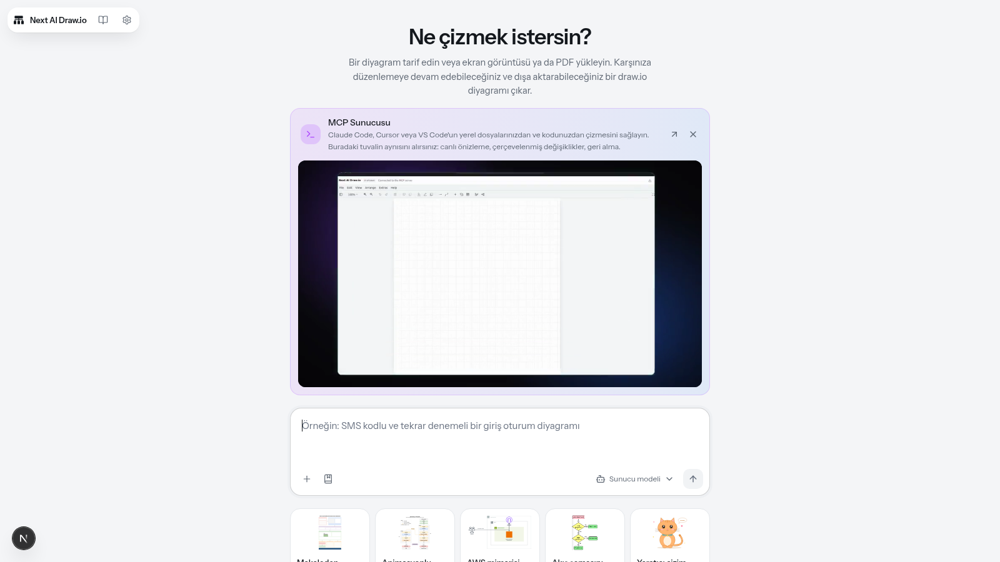
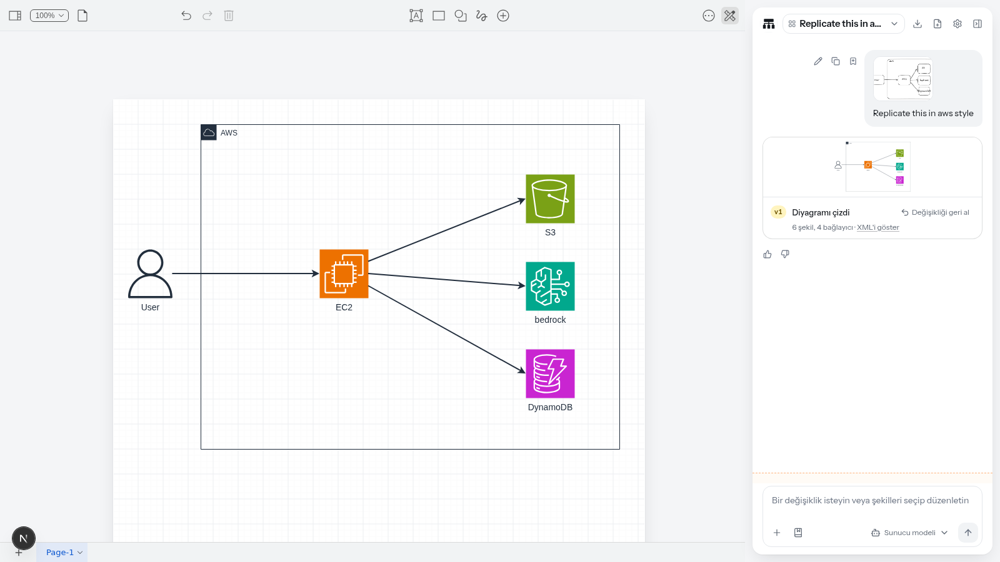
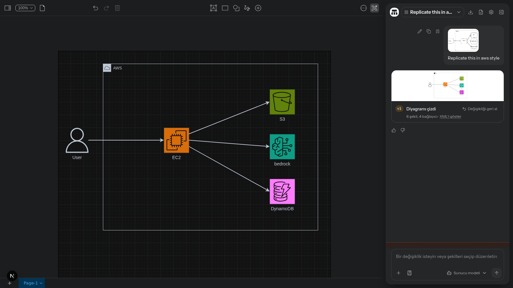
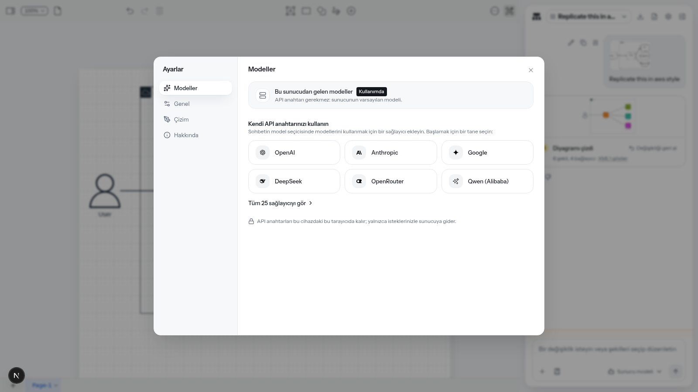
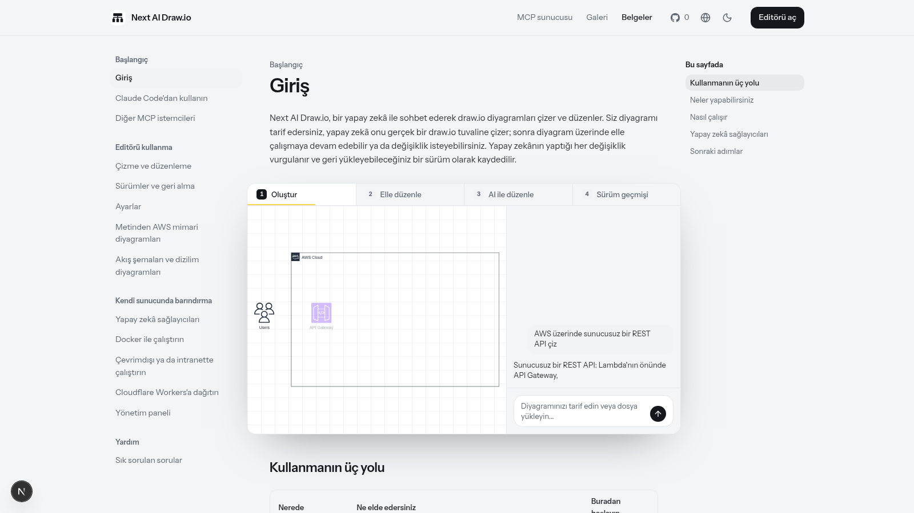
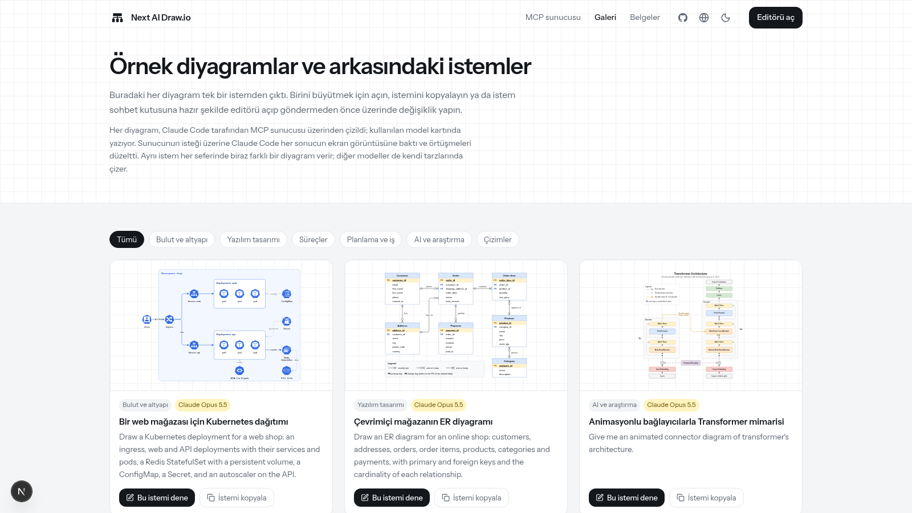
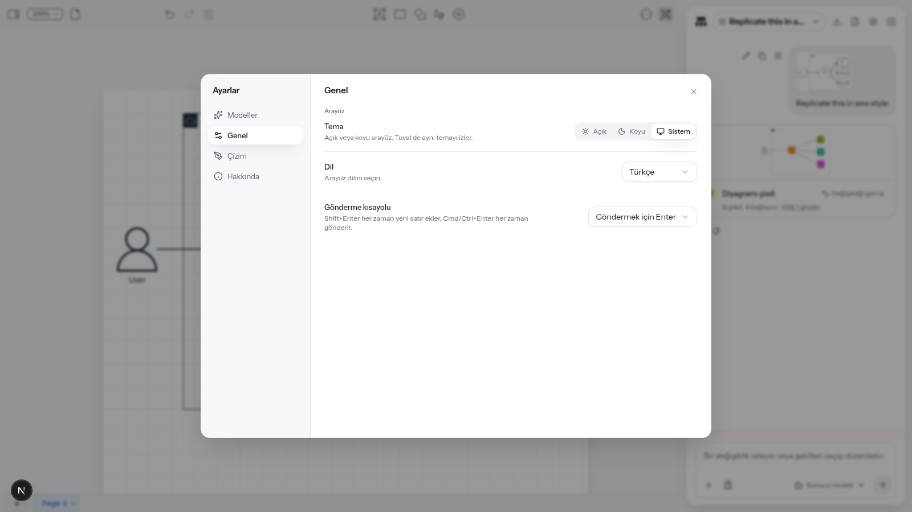
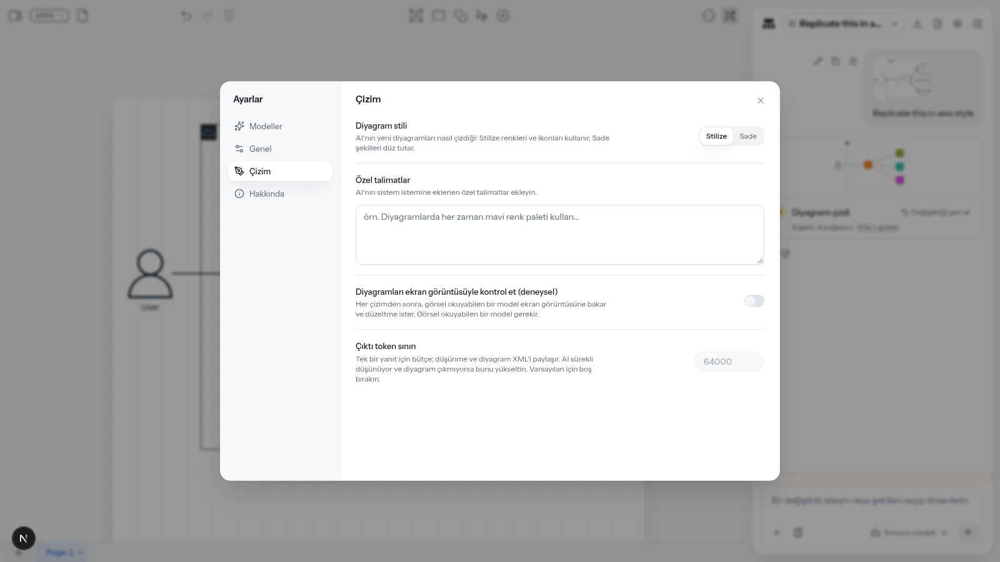
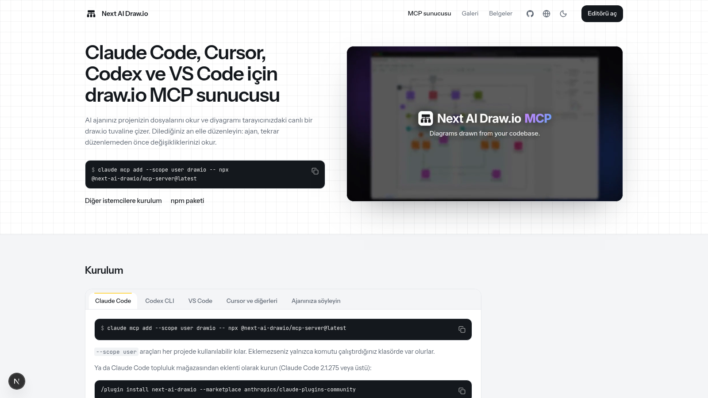

<div align="center">

# Synora

**Yapay zekâ ile sohbet ederek draw.io diyagramları çizin ve düzenleyin — tamamen Türkçe arayüzle. Artık SaaS: hesaplar, planlar ve yönetim paneliyle.**

Türkçe | [English](./README_EN_UPSTREAM.md) · [中文](./docs/cn/README_CN.md) · [日本語](./docs/ja/README_JA.md)

[](https://opensource.org/licenses/Apache-2.0)
[](https://nextjs.org/)
[](https://react.dev/)
[](./docs/tr/introduction.md)

</div>

Bir cümleyle diyagramı tarif edin; yapay zekâ onu gerçek bir draw.io tuvaline çizsin. Herhangi bir draw.io dosyası gibi elle düzenleyin ya da birkaç şekli seçip yapay zekâya ne değiştireceğini söyleyin. Yapay zekânın her değişikliği, karşılaştırılabilir, geri yüklenebilir veya geri alınabilir bir sürüme dönüşür; sonuç `.drawio`, `.png` ya da `.svg` olarak dışa aktarılır.

Proje; web uygulaması, Windows / macOS / Linux için masaüstü uygulaması ve Claude Code, Cursor, VS Code gibi yapay zekâ ajanları için bir MCP sunucusu olarak kullanılabiliyor.

> **Bu proje hakkında:** Synora, [DayuanJiang/next-ai-draw-io](https://github.com/DayuanJiang/next-ai-draw-io) projesi temel alınarak Türkçe arayüzle ve SaaS yetenekleriyle geliştirilmektedir. Arayüzün varsayılan dili Türkçe; 559 arayüz metni ve **14 sayfalık dokümantasyonun tamamı** (`docs/tr/`) Türkçedir.
>
> **SaaS dönüşümü tamamlandı (Faz 1-4):**
> - **Faz 1 — Kimlik:** kayıt ol / giriş yap / şifremi unuttum / şifre sıfırlama panelleri, JWT oturumu (httpOnly çerez), Prisma şeması (User, Plan, PasswordResetToken, Diagram, UsageEvent, Subscription), admin panelinde kullanıcı yönetimi.
> - **Faz 2 — Ürün:** bulutta diyagram kalıcılığı (kaydet/aç/yeniden adlandır/sil), Panelim'de "Diyagramlarım", editörde "Buluta kaydet", oturumlu kullanıcılarda plan bazlı kota (günlük/aylık istek + token), BYOK istekleri muaf.
> - **Faz 3 — Gelir:** fiyatlandırma sayfası, yükseltme talebi akışı (PENDING abonelik), iyzico abonelik iskeleti + webhook (ACTIVE/PAST_DUE/CANCELED senkronu; uçtan uca test edildi).
> - **Faz 4 — KVKK:** gizlilik aydınlatma metni (6698), kullanım şartları, tek tıkla veri dışa aktarma (JSON) ve şifre onaylı kalıcı hesap silme.
>
> Hızlı kurulum: `cp env.example .env` → `DATABASE_URL` ve `AUTH_SECRET` doldur → `npm install` → `npx prisma db push` → `npm run dev`. İlk kayıt olan kullanıcı otomatik yöneticidir.
>
> 📸 **Tüm panellerin ekran görüntüleri ve açıklamaları:** [docs/DEGISIKLIKLER.md](./docs/DEGISIKLIKLER.md)

## Ekran Görüntüleri

| Ana ekran — "Ne çizmek istersin?" | Çalışma alanı — AI çizimi |
|---|---|
|  |  |

| Koyu tema | Ayarlar · Modeller |
|---|---|
|  |  |

| Türkçe Belgeler | Galeri |
|---|---|
|  |  |

| Ayarlar · Genel | Ayarlar · Çizim | MCP Sunucusu |
|---|---|---|
|  |  |  |

### SaaS panelleri

| Giriş | Kayıt Ol | Panelim | Yönetim |
|---|---|---|---|
|  |  |  |  |

| Koyu Tema · Giriş | Koyu Tema · Panelim |
|---|---|
|  |  |

Tüm SaaS sayfaları projenin standart site başlığı ve alt bilgisini paylaşır; tema ve dil menüleri her panelde çalışır. Diğer tüm ekran görüntüleri (şifre sıfırlama, fiyatlandırma, KVKK sayfaları, hesap menüsü) ve tek tek açıklamaları: **[docs/DEGISIKLIKLER.md](./docs/DEGISIKLIKLER.md)**.

## Öne Çıkanlar

**Çiz**

- Mimari diyagramlar, akış şemaları, dizilim diyagramları ve daha fazlası tek bir cümleden; yerleşik **AWS, Azure, GCP ve Kubernetes** simge kitaplıklarıyla
- Bağlayıcılar akış animasyonu taşıyabilir
- Ekran görüntüsü ya da el çizimi bir eskiz yükleyin, yapay zekâ yeniden çizsin; PDF, Markdown, kod ve diğer metin dosyalarını yükleyin, içeriklerinin diyagramını alın
- Bir web sayfasının adresini yapıştırın, içeriğinden diyagram üretinsin

**Düzenle**

- Sohbetle düzenleme: değişiklikler tuvale canlı akar, yapay zekânın az önce değiştirdiği şekiller vurgulanır
- Seçime soru sor: tuvaldeki şekilleri seçin, yapay zekâ yalnızca onları değiştirsin
- Sürümler ve geri alma: yapay zekânın her değişikliği, küçük resimli bir sürüm kartına dönüşür; tuvalle karşılaştırın, geri yükleyin ya da geri alın — tuvalde Ctrl+Z de bir adımda son AI değişikliğini geri alır
- Sonuç sıradan bir draw.io diyagramıdır: çift tıkla yeniden adlandırın, sürükleyin, yeniden biçimlendirin, birden çok sayfa kullanın, istediğiniz an `.drawio`, `.png`, `.svg` ya da `.drawio.svg` olarak dışa aktarın

**Kullan**

- 25 model sağlayıcısı; başka herhangi bir adres için OpenAI uyumlu hazır ayar dahil — kendi API anahtarınızı tarayıcıya girin, anahtar makinenizden çıkmaz
- Akıl yürüten modeller düşüncelerini gösterir
- Koyu tema; arayüz **Türkçe**, İngilizce, Basitleştirilmiş Çince, Geleneksel Çince ve Japonca

## Nasıl Çalışır

Bir diyagram, draw.io XML'idir. Uygulama, isteğinizi ve geçerli diyagramı seçtiğiniz modele gönderir; model yeni ya da değiştirilmiş XML'i araç çağrılarıyla (`display_diagram`, `edit_diagram`, `append_diagram`, `get_shape_library`) üretir ve tuval XML'i gelirken canlı çizer. draw.io editörü uygulamanın içinde paketlenmiştir; bu sayede uygulama editörü doğrudan sürebilir, el düzenlemelerinizi geri okuyabilir ve değişen şekilleri çerçeveleyebilir.

Teknolojiler: **Next.js 16** (App Router) · **React 19** · **Vercel AI SDK** (`ai` + `@ai-sdk/*`) · **draw.io** (same-origin iframe) · **Zustand** · **Tailwind CSS 4** · **Electron** (masaüstü)

## Kullanım

### Çevrimiçi demo

[Orijinal projenin demo sitesini](https://next-ai-drawio.jiang.jp/) kurulum yapmadan deneyebilirsiniz. Demo günlük kullanım sınırına sahiptir; sohbet panelindeki ayarlar simgesinden kendi sağlayıcınızı ve API anahtarınızı girerek sınırı kaldırabilirsiniz. Anahtar yalnızca tarayıcınızda tutulur, sunucuda saklanmaz.

### Masaüstü uygulaması

Windows, macOS ve Linux kurulumlarını [orijinal projenin sürümler sayfasından](https://github.com/DayuanJiang/next-ai-draw-io/releases) indirebilirsiniz.

### Yapay zekâ ajanınızda (MCP)

MCP (Model Context Protocol) üzerinden Claude Code, Claude Desktop, Cursor, VS Code, Codex ve Cline gibi istemciler doğrudan draw.io diyagramı çizebilir. İstemcinizin MCP yapılandırmasına şunu ekleyin:

```json
{
  "mcpServers": {
    "drawio": {
      "command": "npx",
      "args": ["@next-ai-drawio/mcp-server@latest"]
    }
  }
}
```

Claude Code için tek komut yeterlidir (`--scope user` her projede kullanılabilir kılar):

```bash
claude mcp add --scope user drawio -- npx @next-ai-drawio/mcp-server@latest
```

VS Code ve Cursor'da tek tıkla ekleme:

[](https://insiders.vscode.dev/redirect?url=vscode%3Amcp%2Finstall%3F%257B%2522name%2522%253A%2522drawio%2522%252C%2522command%2522%253A%2522npx%2522%252C%2522args%2522%253A%255B%2522%2540next-ai-drawio%252Fmcp-server%2540latest%2522%255D%257D) [](https://cursor.com/en/install-mcp?name=drawio&config=eyJjb21tYW5kIjoibnB4IiwiYXJncyI6WyJAbmV4dC1haS1kcmF3aW8vbWNwLXNlcnZlckBsYXRlc3QiXX0%3D)

Sonra yapay zekâdan "giriş, MFA ve oturum yönetimi içeren bir kullanıcı kimlik doğrulama akış şeması çiz" diye isteyin; diyagram tarayıcınızda çizilirken belirir. MCP sunucusu, web uygulamasındaki çizim özelliklerinin çoğunu taşır:

- Web uygulamasıyla aynı çizim kuralları, simge kitaplıkları (AWS, Azure, GCP, Kubernetes ve daha fazlası) ve tuval: değişiklikler çerçevelenir, Ctrl+Z geri alır, seçtiğiniz şekilleri yapay zekâ okur
- Ekran görüntüsü aracı: yapay zekâ çizilen diyagrama bakıp hataları düzeltir
- Sürüm geçmişi, birden çok sayfa, `.drawio` / `.png` / `.svg` / `.drawio.svg` dışa aktarma ve `~/.next-ai-drawio/` altına otomatik kaydetme; draw.io editörü paketin içinde gelir, önizleme çevrimdışı çalışır

Ayrıntılar: [Claude Code'dan kullanın](./docs/tr/claude-code.md) · [Diğer MCP istemcileri](./docs/tr/mcp-clients.md)

## Örnekler

<div align="center">
<table width="100%">
  <tr>
    <td width="50%" valign="top">
      <strong>AWS üzerinde yüksek erişilebilirlikli web uygulaması</strong><br />
      <p><strong>İstem:</strong> AWS üzerinde iki Availability Zone'a yayılmış, yüksek erişilebilirlikli bir web uygulaması mimarisi çiz, AWS simgeleriyle: Route 53, AWS WAF'lı CloudFront, Application Load Balancer, özel alt ağlarda ECS Fargate servisleri, writer ve reader'lı Aurora PostgreSQL, Redis için ElastiCache, statik dosyalar için S3, NAT gateway'ler ve izleme için CloudWatch.</p>
      <p><strong>Model:</strong> Claude Opus 5.5, Claude Code + MCP sunucusu</p>
      
    </td>
    <td width="50%" valign="top">
      <strong>Web mağazası için Kubernetes dağıtımı</strong><br />
      <p><strong>İstem:</strong> Bir web mağazası için Kubernetes dağıtımı çiz: bir ingress, servisleri ve pod'larıyla web ve API deployment'ları, kalıcı volume'lu bir Redis StatefulSet, bir ConfigMap, bir Secret ve API üzerinde bir autoscaler.</p>
      <p><strong>Model:</strong> Claude Opus 5.5, Claude Code + MCP sunucusu</p>
      
    </td>
  </tr>
  <tr>
    <td width="50%" valign="top">
      <strong>Çevrimiçi mağazanın ER diyagramı</strong><br />
      <p><strong>İstem:</strong> Bir çevrimiçi mağaza için ER diyagramı çiz: müşteriler, adresler, siparişler, sipariş kalemleri, ürünler, kategoriler ve ödemeler; birincil ve yabancı anahtarlarla ve her ilişkinin kardinalitesi.</p>
      <p><strong>Model:</strong> Claude Opus 5.5, Claude Code + MCP sunucusu</p>
      
    </td>
    <td width="50%" valign="top">
      <strong>BPMN gider talebi süreci</strong><br />
      <p><strong>İstem:</strong> Bir gider talebi için BPMN süreci çiz: çalışan talebi gönderir, yönetici onaylar ya da reddeder, finans dekontları kontrol eder ve öder; dekont eksikse talep çalışana geri döner.</p>
      <p><strong>Model:</strong> Claude Opus 5.5, Claude Code + MCP sunucusu</p>
      
    </td>
  </tr>
  <tr>
    <td width="50%" valign="top">
      <strong>Animasyonlu bağlayıcılarla Transformer mimarisi</strong><br />
      <p><strong>İstem:</strong> Transformer mimarisinin animasyonlu bağlayıcılı diyagramını ver.</p>
      <p><strong>Model:</strong> Claude Opus 5.5, Claude Code + MCP sunucusu</p>
      
    </td>
    <td width="50%" valign="top">
      <strong>Bankacılık uygulaması müşteri yolculuğu haritası</strong><br />
      <p><strong>İstem:</strong> Bir mobil bankacılık uygulaması için beş aşamalı (keşfet, kayıt ol, ilk ödeme, günlük kullanım, yardım al) müşteri yolculuğu haritası çiz; her aşamada müşterinin eylemleri, temas noktaları, duyguları ve zorlukları, her zorluk için bir fırsat.</p>
      <p><strong>Model:</strong> Claude Opus 5.5, Claude Code + MCP sunucusu</p>
      
    </td>
  </tr>
</table>
</div>

İstemi ve modeliyle birlikte daha fazla örnek, uygulamanın içindeki **Galeri** sayfasındadır (`/tr/gallery`).

## Kendi Sunucunuzda Çalıştırma

### Yerel çalıştırma

```bash
git clone https://github.com/aliyuzerler/Draw.io
cd Draw.io
npm install
cp env.example .env.local   # sağlayıcınızı ve API anahtarınızı ekleyin, aşağıya bakın
npm run dev
```

[http://localhost:6002](http://localhost:6002) adresini açın. Arayüz varsayılan olarak Türkçe açılır; dil menüsünden İngilizce, Çince ya da Japonca seçebilirsiniz.

### Docker

```bash
docker run -d -p 3000:3000 \
  -e AI_PROVIDER=openai \
  -e AI_MODEL=gpt-4o \
  -e OPENAI_API_KEY=your_api_key \
  ghcr.io/dayuanjiang/next-ai-draw-io:latest
```

Ayrıntılar: [Docker ile çalıştırın](./docs/tr/docker.md).

### Tek tıkla dağıtım

| Platform | Nasıl |
| --- | --- |
| Vercel | [](https://vercel.com/new/clone?repository-url=https%3A%2F%2Fgithub.com%2Faliyuzerler%2FDraw.io) Ortam değişkenlerini Vercel panosunda, `.env.local`dekiyle aynı biçimde ayarlayın |
| Cloudflare Workers | [Cloudflare dağıtım rehberi](./docs/tr/cloudflare-deploy.md) |
| Docker | [Docker rehberi](./docs/tr/docker.md) |
| Çevrimdışı / intranet | [Çevrimdışı dağıtım](./docs/tr/offline-deployment.md) |
| Yönetim paneli | [Yönetim paneli rehberi](./docs/tr/admin-panel.md) |

### Modeller ve sağlayıcılar

25 sağlayıcı desteklenir: AWS Bedrock (varsayılan), OpenAI, Anthropic, Google AI, Google Vertex AI, Azure OpenAI, Ollama, OpenRouter, AIHubMix, DeepSeek, SiliconFlow, SGLang, Vercel AI Gateway, Tencent EdgeOne, ByteDance Doubao, ModelScope, Zhipu GLM, Qwen, Qiniu, Kimi, MiniMax, Novita, Xiaomi MiMo, Atlas Cloud ve herhangi başka bir adres için OpenAI uyumlu hazır ayar (vLLM, LM Studio, API ağ geçidi). Her sağlayıcının ortam değişkenleri ve notları: [Yapay zekâ sağlayıcıları](./docs/tr/ai-providers.md).

**Hangi model:** Görev, katı bir biçime uymak zorunda olan uzun metin (draw.io XML) üretmektir; bu yüzden yetenekli bir model seçin. Küçük modeller genellikle bozuk diyagramlar üretir. Önerilen: Claude Sonnet 4.5 / Opus 4.5, GPT-5.2, Gemini 3 Pro.

**Birden çok model ve yönetim paneli:** `AI_MODEL` içine virgülle ayırarak birkaç model kimliği listeleyin ya da `AI_MODELS_CONFIG` ortam değişkeniyle ya da `ai-models.json` dosyasıyla birden çok sağlayıcının modelini yapılandırın; herkes onları kendi anahtarı olmadan kullanabilir. `ADMIN_PASSWORD` ayarlayıp `/admin` yolunu açarak modelleri, erişim kodlarını, özellik anahtarlarını, gözlemlenebilirliği ve kotaları bir web sayfasından yönetebilirsiniz; bkz. [Yönetim paneli](./docs/tr/admin-panel.md).

## Türkçe Arayüz ve Belgeler

Bu fork'un Türkçe'ye getirdikleri:

- **Arayüz çevirisi**: 559 metin (sohbet, ayarlar, menüler, diyaloglar, hata iletileri, boş durumlar) `lib/i18n/dictionaries/tr.json` içinde; varsayılan dil Türkçe
- **Dokümantasyon**: Aşağıdaki 14 rehberin tamamı Türkçe yazıldı ve uygulamadaki **Belgeler** sayfasında yayımlanır:

| Rehber | Konu |
|---|---|
| [Giriş](./docs/tr/introduction.md) | Proje tanıtımı, kullanım yolları, mimari |
| [Çizme ve düzenleme](./docs/tr/editor.md) | Editör kullanımı, dosya yükleme, dışa aktarma |
| [Sürümler ve geri alma](./docs/tr/versions.md) | Sürüm kartları, karşılaştırma, geri yükleme |
| [Ayarlar](./docs/tr/settings.md) | Genel, çizim ve model ayarları |
| [Metinden AWS mimari diyagramları](./docs/tr/aws-architecture.md) | AWS simgeleriyle mimari çizimi |
| [Akış şemaları ve dizilim diyagramları](./docs/tr/flowcharts.md) | Akış şeması, BPMN, dizilim diyagramı ipuçları |
| [Claude Code'dan kullanın](./docs/tr/claude-code.md) | MCP kurulumu ve kullanımı |
| [Diğer MCP istemcileri](./docs/tr/mcp-clients.md) | Codex, VS Code, Cursor, Cline |
| [Yapay zekâ sağlayıcıları](./docs/tr/ai-providers.md) | 25 sağlayıcının ortam değişkenleri |
| [Docker ile çalıştırın](./docs/tr/docker.md) | Kapsayıcı kurulumu ve yapılandırma |
| [Çevrimdışı ya da intranette çalıştırın](./docs/tr/offline-deployment.md) | İnternetsiz ağlarda kurulum |
| [Cloudflare Workers'a dağıtın](./docs/tr/cloudflare-deploy.md) | OpenNext ile dağıtım |
| [Yönetim paneli](./docs/tr/admin-panel.md) | Sunucu ayarlarını web'den yönetme |
| [Sık sorulan sorular](./docs/tr/FAQ.md) | Sık karşılaşılan sorunlar ve çözümleri |

- **Masaüstü menüleri**: Electron uygulamasının menü metinleri de Türkçe'ye çevrilmiştir
- **SEO ve PWA**: Site başlığı, açıklaması ve manifest Türkçe

Dil ekleme ya da metin değiştirme için: `lib/i18n/dictionaries/tr.json` (arayüz) ve `docs/tr/` (belgeler). Sağlayıcı notları gibi çok dilli metinler `lib/providers.ts` içinde `tr` alanını da taşır.

## Geliştirme

```bash
npm run dev        # geliştirme sunucusu (6002 portu)
npm run build      # üretim derlemesi
npm start          # üretim sunucusu (6001 portu)
npm test           # vitest birim testleri
npm run test:e2e   # playwright uçtan uca testler
```

```
lib/system-prompts.ts      # Yapay zekâya verilen çizim talimatları (İngilizce kalmalı — çevirmeyin)
lib/chat-tools.ts          # 4 AI aracının tanımları (display/edit/append/get_shape_library)
lib/drawio/editor-bridge.ts# React ↔ draw.io iframe köprüsü
lib/i18n/                  # Arayüz çevirileri (tr.json, en.json, ...)
components/workspace/      # Ana çalışma alanı
components/chat/           # Sohbet paneli, sürüm kartları, araç etkinliği
components/canvas/         # Tuval, sürüm şeridi, karşılaştırma penceresi
packages/mcp-server/       # MCP sunucusu (@next-ai-drawio/mcp-server)
electron/                  # Masaüstü uygulaması
docs/tr/                   # Türkçe dokümantasyon
docs/images/               # Bu README'deki ekran görüntüleri
```

> **Not:** `lib/system-prompts.ts` içindeki sistem istemleri bilinçli olarak İngilizce bırakılmıştır; yapay zekânın XML üretim kalitesi İngilizce talimatlara bağlıdır. Kullanıcının gördüğü tüm metinler Türkçe'dir.

## Destek ve Teşekkürler

Bu proje, **[DayuanJiang](https://github.com/DayuanJiang)'ın** [next-ai-draw-io](https://github.com/DayuanJiang/next-ai-draw-io) projesinin bir fork'u üzerinde Türkçe yerelleştirmedir. Orijinal projeye katkılarından dolayı teşekkürler; projeyi beğendiyseniz orijinal depoya yıldız vermeyi ve [sponsora olmayı](https://github.com/sponsors/DayuanJiang) düşünebilirsiniz.

- Sorunlar ve öneriler: bu depoda bir [GitHub issue](https://github.com/aliyuzerler/Draw.io/issues) açın
- Sık karşılaşılan sorunlar: [SSS](./docs/tr/FAQ.md)

## Lisans

[Apache 2.0](./LICENSE)
