# Synora — Yapılan Değişiklikler ve Ekran Görüntüleri

Bu belge, SaaS dönüşümü kapsamında yapılan tüm değişiklikleri **ekran görüntüleriyle** açıklar. Değişiklikler `192666d` (Türkçe arayüz) sonrasına ait **6 commit** içinde, raporda planlanan **4 faz** ve ardından gelen uyum paketi hâlinde geliştirildi:

| Faz | Commit | Kapsam | Bu belgedeki ekranlar |
|---|---|---|---|
| Faz 1 | `7aba80f` | Synora markası, kimlik sistemi, kullanıcı yönetimi | 1, 2, 3, 4, 6, 8 |
| Faz 2 | `ba11df7` | Bulutta diyagram kalıcılığı, kullanıcı bazlı kota | 5, 12 |
| Faz 3 | `c5750a4` | Fiyatlandırma sayfası, abonelik akışı (iyzico) | 9 |
| Faz 4 | `3814f5c` | KVKK uyumu, hesap veri hakları | 5, 10, 11 |
| Cila | `d79a52c` | Fiyatlandırma CTA mantığı, kullanım kartı metni | 9 |
| Düzeltme | `20efff3` | Admin panelinin Synora oturumuyla açılamama hatası + belge | 6 |
| Faz 5 | *(bu commit)* | **Arayüz uyum paketi:** tüm SaaS sayfaları SiteHeader/SiteFooter iskeletine bağlandı; tema + dil menüleri, `--success` token'ları, SEO metadata | 1–5, 9–11, 13, 14 |

Tüm sayfalar yerel geliştirme ortamında (`SQLite` + `next dev`) gerçek oturum açılıp gerçek verilerle gezilerek doğrulandı; **921 birim testin tamamı geçer**.

---

## 1. Giriş Paneli — `/tr/login`

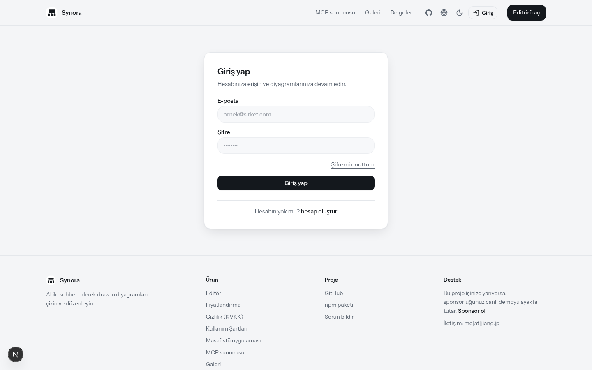

**Faz 1; Faz 5 ile site iskeleti.** Uygulamanın ilk kimlik sayfası. Üst çubuk artık projenin standart site başlığı: marka, MCP/Galeri/Belgeler gezinmesi, GitHub, **dil menüsü**, **tema düğmesi** ve oturum düğmesi; altta site footer'ı. Ortada kart:

- **E-posta + Şifre** alanları; `ornek@sirket.com` ve noktalı parola ipuçlarıyla,
- **Şifremi unuttum** bağlantısı → 3. panele gider,
- **Hesabın yok mu? hesap oluştur** bağlantısı → 2. panele gider.

Teknik: `/api/auth/login` e-postayı bcrypt ile doğrular, `AUTH_SECRET` ile imzalı **httpOnly çerez** (`synora_session`, 30 gün) verir. Hatalı denemeler 15 dakikada 5 ile sınırlandırılır (IP + e-posta bazlı hız limiti).

---

## 2. Kayıt Ol Paneli — `/tr/register`

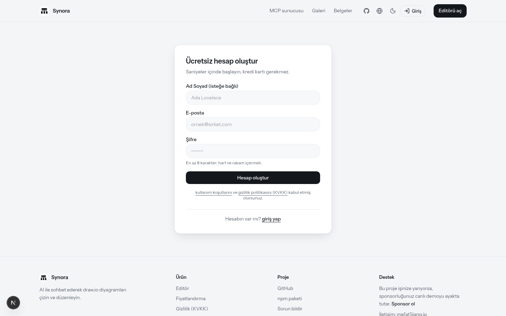

**Faz 1.** "Ücretsiz hesap oluştur" kartı:

- **Ad Soyad** (isteğe bağlı), **E-posta**, **Şifre** ("En az 8 karakter; harf ve rakam içermeli" ipucuyla),
- **KVKK notu:** "Kayıt olarak kullanım koşullarını ve gizlilik politikasını (KVKK) kabul etmiş olursunuz." — bağlantılar Faz 4'te yayımlanan sayfalara gider.

Teknik: `/api/auth/register` parolayı **bcrypt (10 tur)** ile özetler; `ADMIN_EMAILS` ortam değişkenindeki adresler ve **ilk kayıt olan kullanıcı** otomatik `ADMIN` rolü alır. Kayıt sonrası oturum açılır ve doğrudan `/tr/dashboard`'a gidilir.

---

## 3. Şifremi Unuttum Paneli — `/tr/forgot-password`

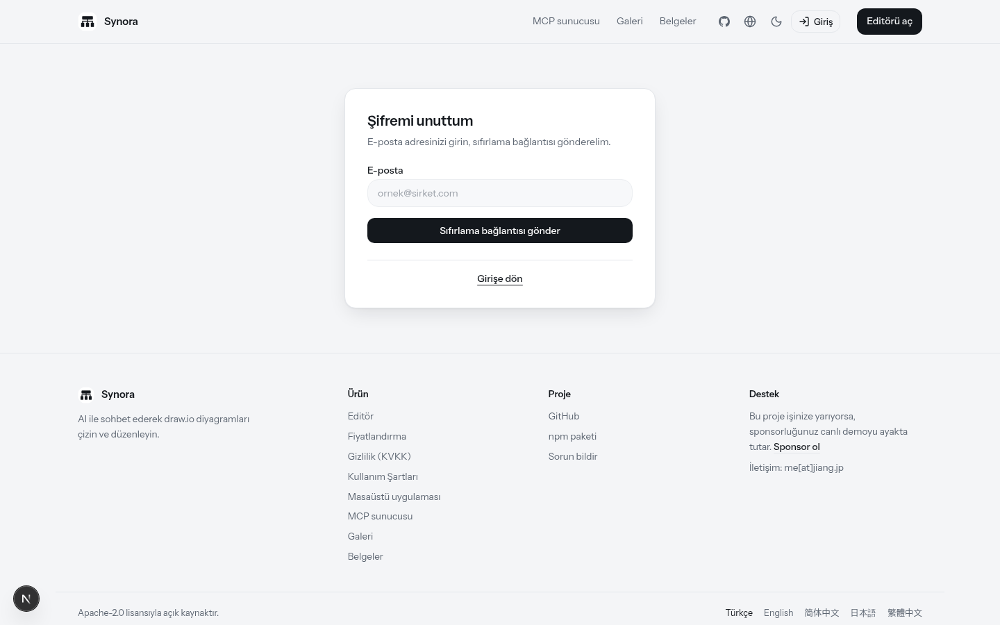

**Faz 1.** Tek e-posta alanı ve "Sıfırlama bağlantısı gönder" düğmesi.

Teknik: `/api/auth/forgot-password` her koşulda aynı genel yanıtı döndürür ("Bu e-posta adresi kayıtlıysa …") — böylece hangi adreslerin kayıtlı olduğu sızdırılmaz. Kayıtlı adresler için **SHA-256 özeti saklanan** tek kullanımlık token üretilir (düz token asla veritabanına yazılmaz), 1 saat sonra geçersizleşir. `RESEND_API_KEY` tanımlıysa bağlantı e-posta ile gönderilir; geliştirmede `DEMO_RESET_LINK=1` ile bağlantı yanıtta da gösterilir.

---

## 4. Şifre Sıfırlama Paneli — `/tr/reset-password?token=…`

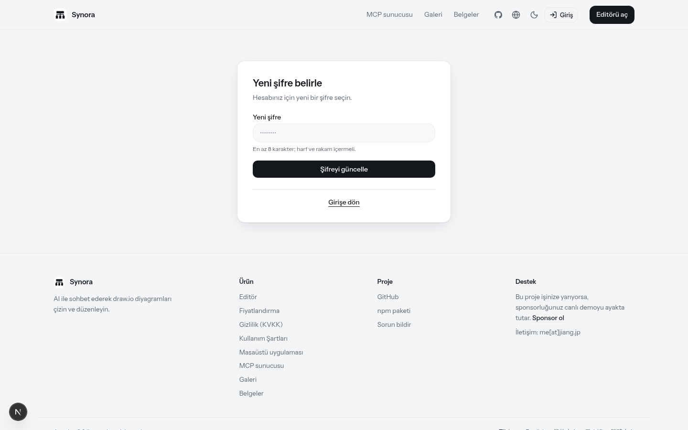

**Faz 1.** E-postadaki bağlantıdan gelinir; ekran görüntüsü **gerçek bir token ile** alınmıştır. "Yeni şifre belirle" kartı, parola ipucu ve "Şifreyi güncelle" düğmesi içerir.

Teknik: `/api/auth/reset-password` token'ın SHA-256 özetini veritabanındakiyle eşler, süresi ve kullanılmamış olduğunu doğrular, parolayı günceller ve token'ı `usedAt` ile tüketir. Aynı bağlantı ikinci kez kullanılamaz.

> Not: Güvenlik katmanı (proxy.ts), oturumu açık kullanıcıyı giriş/kayıt/sıfırlama sayfalarına sokmayıp panele yönlendirir; tasarım gereğidir.

---

## 5. Panelim — `/tr/dashboard`

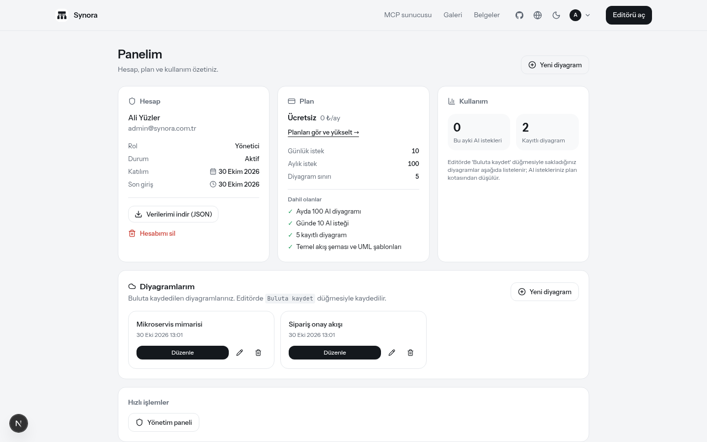

**Faz 2 + 4; Faz 5 ile site başlığı.** Oturum açan herkesin kişisel paneli; üç kart + iki bölüm:

- **Hesap kartı:** ad, e-posta, **Rol** (Yönetici/Üye), **Durum** (Aktif/Askıda), Katılım ve Son giriş tarihleri. Altında Faz 4'ün veri hakları: **"Verilerimi indir (JSON)"** (hesap + diyagram + kullanım verilerini tek dosyada dışa aktarır) ve **"Hesabımı sil"** (şifre onayı istenir, tüm veriler kalıcı silinir — KVKK m. 11).
- **Plan kartı:** geçerli plan (Ücretsiz 0 ₺/ay), **"Planları gör ve yükselt →"** bağlantısı, günlük/aylık istek ve diyagram sınırları ile **"Dahil olanlar"** listesi.
- **Kullanım kartı:** bu ayki AI isteği ve kayıtlı diyagram sayısı canlı sayaçlarla; kota düşümü açıklaması.
- **Diyagramlarım:** "Buluta kaydet" ile saklanan diyagramlar kart hâlinde listelenir; her kartta **Düzenle** (editörde açar), yeniden adlandır ve sil düğmeleri.
- **Hızlı işlemler:** yöneticilere "Yönetim paneli" kısayolu.

Teknik: `/api/diagrams` (GET/POST) ve `/api/diagrams/[id]` (PUT/DELETE) — her sorgu oturum sahibiyle sınırlandırılır (başkasının diyagramına 404). Plan sınırları `Plan` tablosundan okunur.

---

## 6. Yönetim Paneli — `/tr/admin`

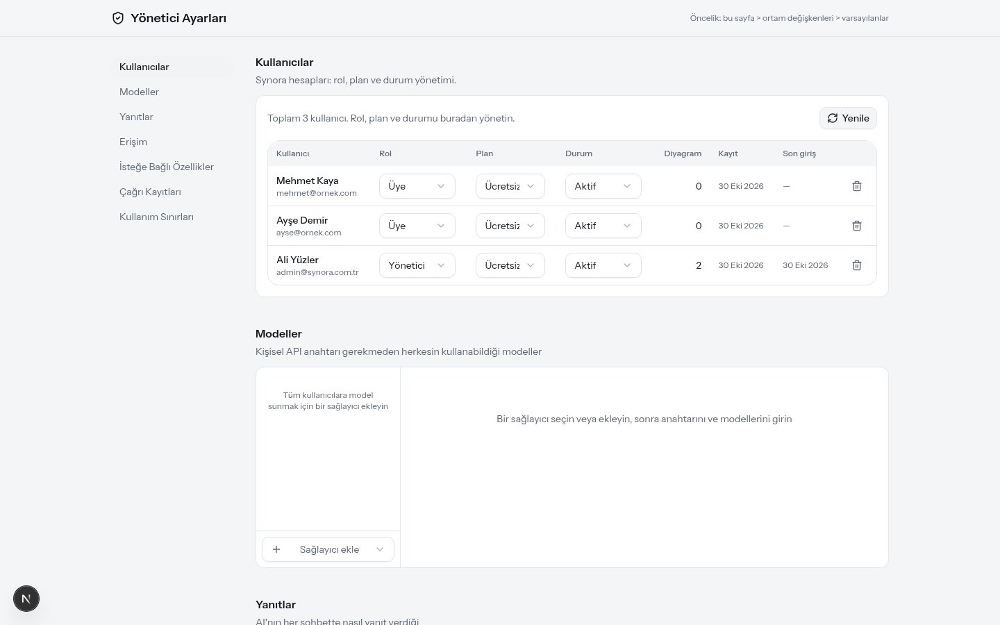

**Faz 1.** Mevcut yönetici ayarlarına **Kullanıcılar bölümü** eklendi: toplam kullanıcı sayısı, tabloda kullanıcı başına **Rol** (Üye/Yönetici), **Plan** (Ücretsiz/Pro/Ekip) ve **Durum** (Aktif/Askıda) açılır menüleri, diyagram sayısı, katılım tarihi ve satır silme düğmesi. Değişiklikler `/api/admin/users` üzerinden anında uygulanır; kenar çubuğunda kullanıcı yönetimi ilk sıraya alındı.

🛠 **Bu ekran görüntüleri alınırken bir hata bulundu ve düzeltildi:** panel, `ADMIN` rolüne sahip Synora oturumuyla açıldığında boş şifre değeri (`""`) "giriş yapılmamış" sayıldığı için şifre ekranı bir türlü kapanmıyordu; yalnızca klasik `ADMIN_PASSWORD` yolu çalışıyordu. `authedPassword` denetimleri `null` karşılaştırmasına çevrilerek oturumlu yöneticilerin panelsiz girmesi sağlandı.

---

## 7. Ana Sayfa / Editör — Synora markası

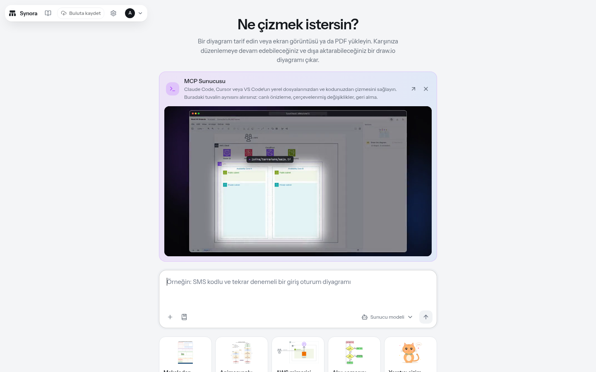

**Faz 1 (marka) + Faz 2 (Buluta kaydet).** Tüm arayüz **Synora** olarak yeniden adlandırıldı: logolu marka işareti (`BrandMark`), sekme başlıkları ("Giriş Yap | Synora"), PWA manifest, footer telif satırı ve kimlik sayfalarının ortak çerçevesi. Başlangıç çubuğunda oturum açan kullanıcı için yeni **"Buluta kaydet"** düğmesi görünür — tuvaldeki diyagramı hesabınıza yazar (tuval boşken düğme etkin değildir). Sağ üstte ayarlar ve hesap menüsü yer alır.

---

## 8. Kullanıcı (Hesap) Menüsü

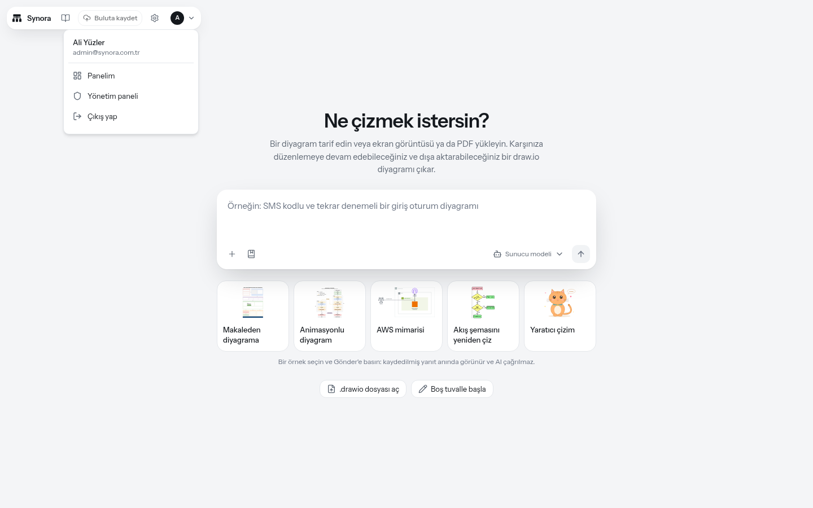

**Faz 1.** Editör başlığındaki avatar düğmesi açılır menü: kullanıcı adı + e-posta başlığı, **Panelim**, yöneticilere özel **Yönetim paneli** ve **Çıkış yap**. Giriş yapmamış ziyaretçiye aynı konumda "Giriş" bağlantısı gösterilir.

---

## 9. Fiyatlandırma — `/tr/pricing`

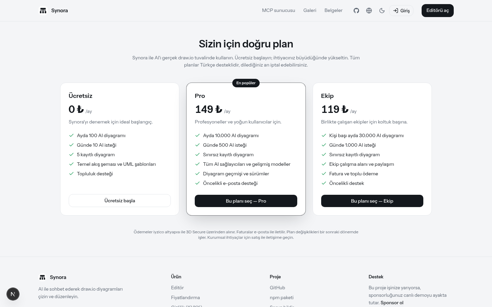

**Faz 3; Faz 5 ile site iskeleti ve TR/EN metinler.** Rapordaki Freemium yapısının vitrine çıkan hâli:

| Plan | Fiyat | Öne çıkanlar |
|---|---|---|
| **Ücretsiz** | 0 ₺/ay | Ayda 100 AI diyagramı, günde 10 istek, 5 kayıtlı diyagram |
| **Pro** (En popüler) | 149 ₺/ay | Ayda 10.000 diyagram, sınırsız kayıt, tüm sağlayıcılar, sürümler |
| **Ekip** | 119 ₺/kişi/ay | Kişi başı 30.000 diyagram, ekip çalışma alanı, fatura ve toplu ödeme |

**CTA mantığı** (cila commit'i): ziyaretçi ve Ücretsiz üyeler "Yükselt — Pro/Ekip" düğmesi görür; o planın sahibiyseniz düğme "Mevcut planınız" olarak devre dışı çizilir (ekran görüntüsündeki Ücretsiz kartı). Alt not ödemelerin **iyzico altyapısı ve 3D Secure** ile alınacağını, faturaların e-posta ile iletileceğini belirtir.

Teknik: "Yükselt" düğmesi `/api/billing/checkout`'a abonelik talebi açar (iyzico anahtarları tanımlıysa iyzico aboneliği, değilse **manuel onay kuyruğunda PENDING kayıt**). `/api/billing/iyzico/webhook` ise ACTIVE/PAST_DUE/CANCELED olaylarını `Subscription` tablosuna ve kullanıcı planına yansıtır; imza doğrulaması `IYZICO_WEBHOOK_SECRET` ile yapılır.

---

## 10. Gizlilik Politikası (KVKK) — `/tr/privacy`

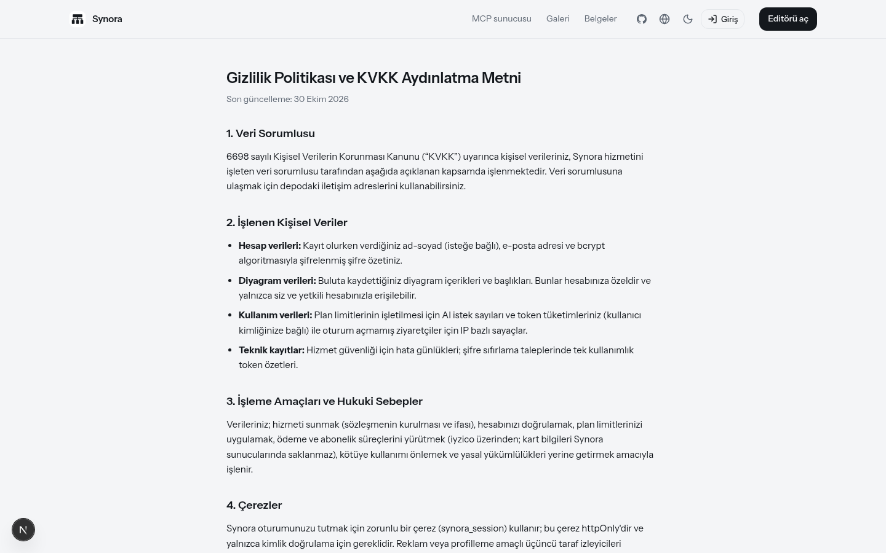

**Faz 4; Faz 5 ile site iskeleti.** 6698 sayılı KVKK'ya uygun aydınlatma metni: veri sorumlusu, işlenen veri kategorileri (hesap, diyagram, kullanım, teknik kayıtlar), işleme amaçları ve hukuki sebepler, çerez politikası (yalnızca zorunlu `synora_session` çerezi), saklama süreleri, üçüncü taraflar (iyzico'da kart verisi saklanmaz) ve haklarınız. Kayıt panelindeki "gizlilik politikasını (KVKK)" bağlantısı bu sayfaya gider.

---

## 11. Kullanım Şartları — `/tr/terms`

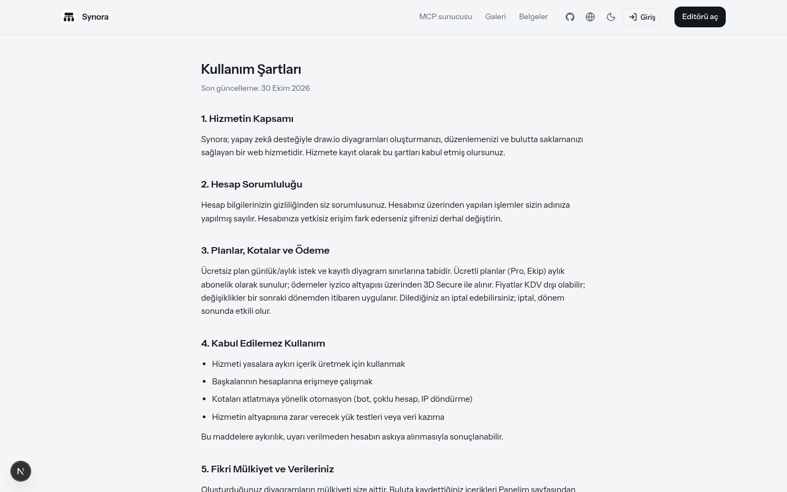

**Faz 4.** Hizmetin tanımı, hesap sorumlulukları, planlar ve faturalandırma (iyzico, iptal koşulları), kabul edilebilir kullanım, fikri mülkiyet (diyagramlar kullanıcıya aittir), hizmet desteği sınırları ve sözleşme değişikliği hükümleri.

---

## 12. Editörde Buluttan Yüklenen Diyagram

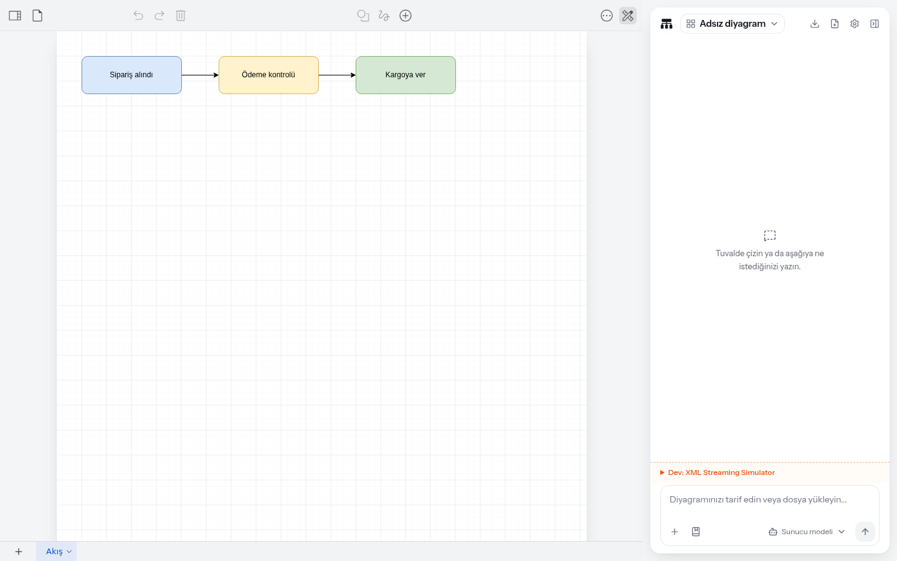

**Faz 2.** Panelim → **Düzenle** ile açılan kayıtlı diyagram (`?diagram=<id>`): tuvalde diyagram, sağda sohbet paneli. Aynı akış "Buluta kaydet" ile tersine çalışır; her iki yön de oturum çereziyle kimliklendirilir ve kota hesabına yazılır.

---

## 13. Giriş Paneli — Koyu Tema

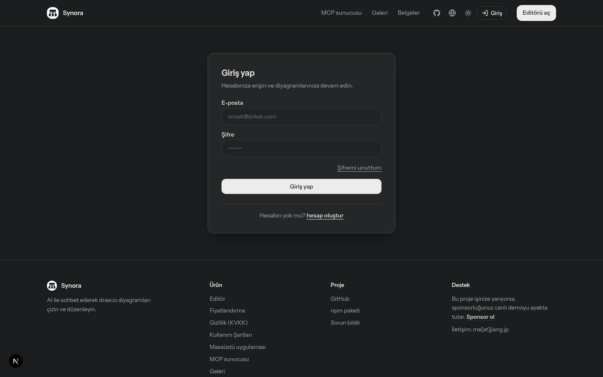

**Faz 5.** Kimlik sayfaları artık projenin gerçek `SiteHeader` ve `SiteFooter` iskeletini kullanıyor: üst çubukta MCP / Galeri / Belgeler gezinmesi, GitHub yıldızı, **dil menüsü**, **tema düğmesi** ve oturum menüsü; altta ürün/proje/destek sütunları. Koyu tema, tasarım token'ları sayesinde kimlik kartlarına da otomatik uygulanıyor — ayrıca tema ayarı tüm sayfalarda korunuyor.

## 14. Panelim — Koyu Tema ve Hesap Menüsü Entegrasyonu

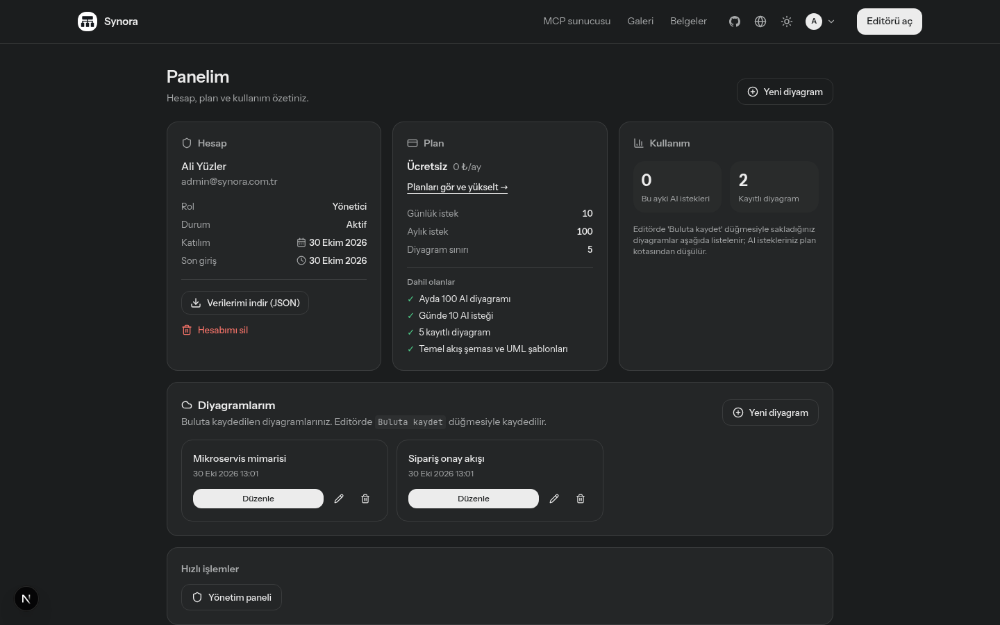

**Faz 5.** Panelim'deki elle yazılmış üst çubuk (marka + "Editöre dön" + Çıkış düğmesi) kaldırıldı; SiteHeader'daki **hesap menüsü** (Panelim, Yönetim paneli, Çıkış yap) bu işlevlerin tamamını üstlendi — editör başlangıç çubuğundaki menüyle birebir aynı. Sayfa `noindex` olarak işaretlendi.

---

## Ortam Değişkenleri Özeti

| Değişken | Amaç |
|---|---|
| `DATABASE_URL` | Geliştirmede SQLite (`file:./prisma/synora.db`); üretimde Neon/PostgreSQL için `prisma/schema.prisma` içinde `provider = "postgresql"` |
| `AUTH_SECRET` | Oturum çerezinin imza anahtarı (`openssl rand -base64 32`) |
| `ADMIN_EMAILS` | Bu adreslerle kayıt olanlar yönetici olur |
| `RESEND_API_KEY`, `RESEND_FROM` | Şifre sıfırlama e-postaları (Resend); yoksa `DEMO_RESET_LINK=1` ile geliştirmede bağlantı gösterilir |
| `IYZICO_API_KEY`, `IYZICO_SECRET_KEY`, `IYZICO_PLAN_REFERENCE_MAP`, `IYZICO_WEBHOOK_SECRET` | iyzico abonelik akışı; tanımsızsa yükseltmeler manuel onaya düşer |
| `NEXT_PUBLIC_SITE_URL` | SEO ve e-posta bağlantılarında kullanılan kamuya açık adres |

## Sıradaki Adımlar

1. **Üretim veritabanı:** Neon PostgreSQL bağlantısı + `prisma db push` (şema kolon adları SQLite ile aynı kalır).
2. **E-posta:** Resend hesabı ve doğrulanmış gönderici alanı — sıfırlama bağlantıları üretimde yalnızca e-postadan geçer.
3. **iyzico sandbox:** Ürün/plan referansları oluşturulup `IYZICO_*` değişkenleri doldurulur, webhook uçtan uca test edilir.
4. **Vercel dağıtımı:** `aliafsar` projesi için yukarıdaki değişkenler ortam paneline girilir; build zaten doğrulandı.
